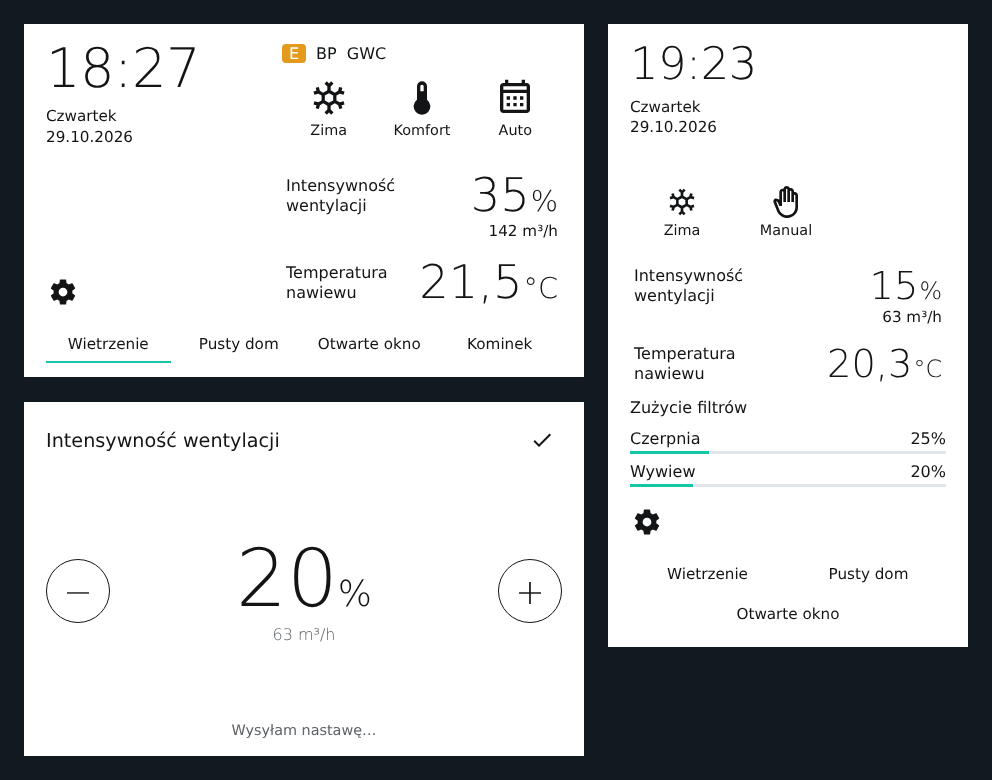
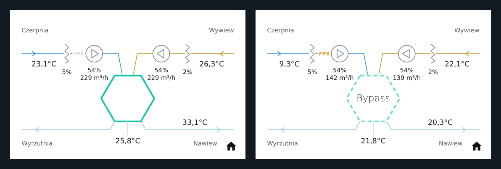

# Thessla AirPack card

[](https://hacs.xyz/docs/faq/custom_repositories/)
[](https://github.com/tomaszsluszniak/thessla-airpack-card/releases/latest)
[](LICENSE)

Karta Home Assistant dla rekuperatorów Thessla Green AirPack, w układzie ekranu głównego panelu ściennego:
zegar, sezon, EKO/KOMFORT i tryb pracy, intensywność wentylacji z przepływem, temperatura nawiewu,
zużycie filtrów, funkcje specjalne oraz schemat przepływu powietrza.

*Home Assistant dashboard card for Thessla Green AirPack heat recovery units. The card's interface and
documentation are in Polish.*



> [!NOTE]
> Projekt niezależny, niezwiązany z firmą Thessla Green. Karta nie zawiera logo ani grafik producenta.

## Wymagania

- Home Assistant **2024.1** lub nowszy,
- rekuperator z encjami w Home Assistant: z komponentu
  [esphome-thessla-airpack](https://github.com/tomaszsluszniak/esphome-thessla-airpack) albo z własnej
  konfiguracji `modbus_controller`.

## Instalacja

Najprościej przez [HACS](https://hacs.xyz):

[](https://my.home-assistant.io/redirect/hacs_repository/?owner=tomaszsluszniak&repository=thessla-airpack-card&category=plugin)

Albo ręcznie w HACS: menu ⋮ → **Custom repositories** → wklej
`https://github.com/tomaszsluszniak/thessla-airpack-card`, wybierz typ **Dashboard**, potem **Download**.

Po instalacji odśwież przeglądarkę (w aplikacji mobilnej: zamknij i otwórz aplikację).

<details>
<summary>Instalacja ręczna</summary>

1. Pobierz `thessla-airpack-card.js` z [najnowszego wydania](https://github.com/tomaszsluszniak/thessla-airpack-card/releases/latest).
2. Skopiuj do `/config/www/`.
3. Ustawienia → Panele → ⋮ → Zasoby → Dodaj `/local/thessla-airpack-card.js`, typ *Moduł JavaScript*.

</details>

## Konfiguracja

```yaml
type: custom:thessla-airpack-card
```

To wystarczy: karta sama znajduje rekuperator i jego encje. Rozpoznaje też typowe konfiguracje
`modbus_controller` (np. intensywność jako select „15%”, „20%”…). Jeśli jakiejś encji nie znajdzie,
przypisz ją ręcznie w `entities`.

| Opcja | Domyślnie | Opis |
|---|---|---|
| `device` | wykrywane | `device_id`, gdy masz więcej niż jedną centralę |
| `entities` | wykrywane | ręczne przypisanie encji, np. `mode: select.airpack4_tryb_pracy` |
| `step` | `5` | krok przycisków −/+ (w %) |
| `functions` | `[airing, empty, windows, fireplace]` | funkcje w dolnym rzędzie |

<details>
<summary>Klucze <code>entities</code></summary>

`mode`, `season`, `special`, `comfort`, `intensity`, `intensity_now`, `setpoint`, `power`, `outside`, `supply`,
`extract`, `fpx_temp`, `ambient`, `supply_flow`, `extract_flow`, `supply_percent`, `extract_percent`,
`filter_supply`, `filter_extract`, `alarm_s`, `alarm_e`, `bypass`, `gwc`, `fpx`, `erv`, `hood`, `humidistat`,
`air_quality`, `online`, `clock`, `comfort_status`.

</details>

## Obsługa

- **Lato/Zima, Eko/Komfort, Auto/Manual**: dotknięcie ikony przełącza ustawienie. Zmiana pokazuje się od razu,
  a intensywność i przepływ są wyszarzone, dopóki centrala nie przeliczy nowych wartości.
- **Intensywność**: dotknięcie otwiera regulację −/+. W trybie MANUAL zmienia nastawę manualną, w AUTO
  uruchamia tryb chwilowy.
- **Temperatura nawiewu**: w trybie Komfort regulacja nastawy co 0,5 °C.
- **Zużycie filtrów**: dotknięcie otwiera schemat przepływu z temperaturami, zużyciem filtrów,
  intensywnością i przepływem wentylatorów oraz sprawnością odzysku ciepła.
- **Koło zębate**: wszystkie odczyty i wyłącznik centrali (wyłączenie wymaga drugiego dotknięcia).
- U góry pojawiają się kody aktywnych stanów: BP, GWC, FPX, ERV, OKAP, H2O, JP oraz alarmy S i E.



## Zegar

Jeśli istnieje encja „Zegar centrali”, karta pokazuje czas rekuperatora; w przeciwnym razie czas urządzenia,
na którym jest wyświetlana.

## Zgłoszenia

Błędy i pomysły zgłaszaj w [Issues](https://github.com/tomaszsluszniak/thessla-airpack-card/issues).
Dołącz wersję karty (widać ją w konsoli przeglądarki) i sposób podłączenia rekuperatora do Home Assistant.

## Licencja

[MIT](LICENSE)
